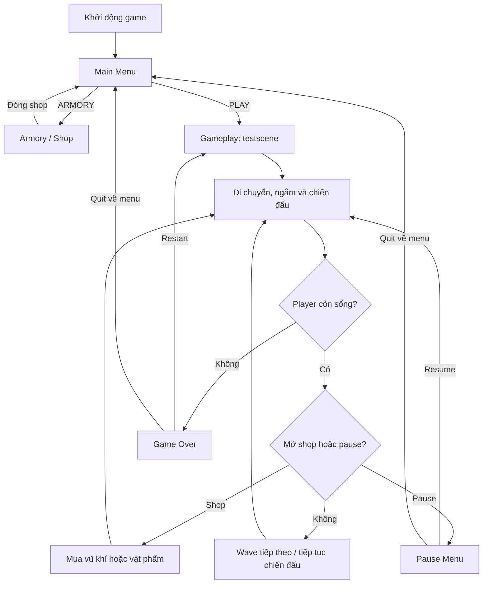
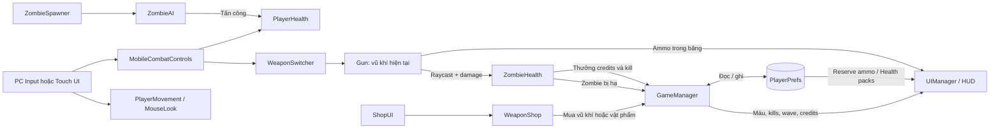

# cái này dành cho game 3d ==>> bỏ qua cái này, khi nào chỉ đích danh đến file này thì mới dùng

# BÁO CÁO TÓM TẮT ĐỒ ÁN

## Xây dựng game bắn zombie 3D trên nền tảng Android bằng Unity

> Tài liệu tóm tắt dựa trên cấu trúc scene, script và hướng dẫn hiện có trong project. Có thể bổ sung tên sinh viên, lớp, giảng viên, hình ảnh minh họa và kết quả kiểm thử trước khi nộp.

## 1. Thông tin chung

| Hạng mục          | Nội dung                                                      |
| ----------------- | ------------------------------------------------------------- |
| Tên đề tài        | Xây dựng game bắn zombie 3D trên nền tảng Android             |
| Tên project       | ZombieShooting                                                |
| Thể loại          | FPS (bắn súng góc nhìn thứ nhất), sinh tồn, zombie            |
| Công cụ chính     | Unity 6.0 (6000.6.5f1), C#                                    |
| Nền tảng mục tiêu | Android; cấu hình dự án cũng hỗ trợ chạy thử trên PC          |
| Scene chính       | `MainMenu`, `testscene`                                       |
| Lưu trữ dữ liệu   | `PlayerPrefs` trên thiết bị, không sử dụng máy chủ trực tuyến |

## 2. Tóm tắt đề tài

Đề tài xây dựng một trò chơi bắn zombie góc nhìn thứ nhất, trong đó người chơi di chuyển trong bản đồ 3D, sử dụng súng để tiêu diệt zombie và sống sót qua các đợt tấn công. Người chơi nhận tiền thưởng khi hạ zombie, dùng tiền mua vũ khí và vật phẩm tại Armory. Trò chơi có HUD, quản lý máu, đạn, số mạng tiêu diệt, wave, tạm dừng và màn hình kết thúc.

Project có scene menu chính để bắt đầu trò chơi hoặc mở Armory. Gameplay đã có logic điều khiển cảm ứng và inventory cho Android; các thành phần UI cảm ứng được thiết kế để dựng, sắp xếp và nối tham chiếu trong Unity Editor nhằm phù hợp giao diện thực tế của người phát triển.

## 3. Mục tiêu và phạm vi

### 3.1 Mục tiêu

- Xây dựng vòng lặp gameplay FPS cơ bản trong môi trường 3D.
- Tổ chức mã nguồn thành các hệ thống Player, Weapon, Enemy, UI, Shop và Manager.
- Tạo đối thủ có khả năng phát hiện, truy đuổi và tấn công người chơi.
- Tạo cơ chế wave, thưởng tiền và mua sắm vật phẩm.
- Hỗ trợ lưu credits, vũ khí đã mở khóa, đạn dự trữ và health pack qua các scene/lần chơi.
- Chuẩn bị logic điều khiển cảm ứng phù hợp thiết bị Android.

### 3.2 Phạm vi hiện tại

Đề tài tập trung vào game chơi đơn và lưu dữ liệu cục bộ. Project không có backend, tài khoản người chơi, chơi mạng, thanh toán thật hoặc đồng bộ đám mây. Gameplay, UI và cấu hình thiết bị cần được kiểm tra trên Unity Editor và thiết bị Android trước khi đánh giá là bản phát hành hoàn chỉnh.

## 4. Công nghệ và tài nguyên

- **Unity 6 / C#**: xây dựng scene, GameObject, component và vòng đời gameplay.
- **Unity UI, TextMeshPro, EventSystem**: giao diện, HUD và điều khiển nút.
- **Unity NavMesh / NavMeshAgent**: di chuyển và truy đuổi của zombie.
- **Physics Raycast**: kiểm tra đường đạn và phát hiện mục tiêu bị bắn.
- **PlayerPrefs**: lưu credits, lượng đạn dự trữ, số health pack và trạng thái mở khóa vũ khí.
- **Tài nguyên 3D trong project**: mô hình zombie, vũ khí và đạo cụ bản đồ.

## 5. Người chơi và vòng lặp gameplay

1. Từ Main Menu, người chơi bắt đầu trận hoặc mở Armory.
2. Khi vào gameplay, Player sử dụng camera góc nhìn thứ nhất để quan sát và ngắm.
3. Zombie xuất hiện tại các spawn point; khi phát hiện Player, chúng chuyển sang truy đuổi và tấn công ở cự ly gần.
4. Người chơi bắn zombie. Đạn được trừ khỏi băng; khi nạp, đạn được chuyển từ reserve inventory vào băng.
5. Hạ zombie làm tăng kill count và cộng tiền thưởng vào số dư.
6. Người chơi có thể mở shop để mua vũ khí, đạn hoặc health pack.
7. Khi sức khỏe về 0, game hiển thị Game Over. Người chơi có thể chơi lại hoặc quay về Main Menu.

### Sơ đồ luồng màn chơi

## 6. Kiến trúc các hệ thống

| Hệ thống           | Script tiêu biểu                                                               | Trách nhiệm                                                                   |
| ------------------ | ------------------------------------------------------------------------------ | ----------------------------------------------------------------------------- |
| Điều khiển Player  | `PlayerMovement`, `MouseLook`, `PlayerHealth`                                  | Di chuyển, camera, máu, hồi máu và dùng health pack                           |
| Điều khiển cảm ứng | `VirtualJoystick`, `TouchLookArea`, `MobileFireButton`, `MobileCombatControls` | Đọc joystick, thao tác ngắm và nối nút chiến đấu/menu với gameplay            |
| Vũ khí             | `Gun`, `WeaponSwitcher`                                                        | Bắn bằng raycast, đạn trong băng, reload và chuyển vũ khí                     |
| Zombie             | `ZombieAI`, `ZombieHealth`, `ZombieSpawner`                                    | AI theo trạng thái, máu/tiêu diệt và spawn theo wave                          |
| Quản lý trận       | `GameManager`                                                                  | Credits, kills, wave, pause, game over, scene navigation và dữ liệu inventory |
| Cửa hàng           | `WeaponShop`, `ShopUI`                                                         | Catalog vũ khí, giao dịch, giá, trạng thái sở hữu và nhãn inventory           |
| Giao diện          | `MainMenuController`, `UIManager`                                              | Điều hướng menu, HUD, Pause, Shop và Game Over                                |
| Âm thanh/hiệu ứng  | `AudioManager`, `ImpactEffect`                                                 | Phát nhạc/âm thanh và hiệu ứng va chạm đạn                                    |

Các script là logic gắn lên GameObject; UI được dựng trực tiếp trong Unity Editor và các tham chiếu được gán trong Inspector. Vì vậy, hiển thị và thao tác thực tế phụ thuộc vào việc hoàn tất wiring của scene.

## 7. Sơ đồ luồng dữ liệu

### 7.1 Mô tả dữ liệu chính

| Dữ liệu           | Nơi phát sinh/thay đổi                    | Nơi lưu hoặc sử dụng                                                                             |
| ----------------- | ----------------------------------------- | ------------------------------------------------------------------------------------------------ |
| Credits           | Thưởng khi hạ zombie; trừ khi mua hàng    | `GameManager`, khóa `PlayerMoney` trong PlayerPrefs, HUD và Shop                                 |
| Vũ khí đã mở khóa | Giao dịch mua vũ khí                      | Khóa `WeaponUnlocked_<tên vũ khí>` trong PlayerPrefs; catalog nạp vào WeaponHolder khi có Player |
| Reserve ammo      | Mua gói đạn; trừ khi reload               | Khóa `ReserveAmmo`; `Gun` chuyển số đạn khả dụng vào băng                                        |
| Health pack       | Mua pack; trừ khi sử dụng                 | Khóa `HealthPacks`; `PlayerHealth` dùng pack để hồi 50 HP                                        |
| Ammo trong băng   | Bắn hoặc reload                           | Trường `currentAmmo` của vũ khí đang hoạt động; hiển thị trên HUD                                |
| Máu Player        | Bị zombie tấn công, tự hồi hoặc dùng pack | `PlayerHealth`; cập nhật thanh máu và xác định Game Over                                         |
| Kills / wave      | Zombie bị hạ; spawner bắt đầu wave        | `GameManager`; hiển thị trong HUD và Game Over                                                   |

`PlayerPrefs` là lưu trữ cục bộ của Unity. Đây không phải cơ sở dữ liệu online và dữ liệu có thể bị xóa khi người dùng xóa dữ liệu ứng dụng hoặc cài lại game.

## 8. Thiết kế gameplay và thông số tiêu biểu

- **Player**: máu tối đa mặc định 100; có logic tự hồi máu sau khoảng chờ.
- **Vũ khí**: có sát thương, tốc độ bắn, dung lượng băng, thời gian reload và tầm bắn; dữ liệu catalog hiện có AK74 và Shotgun.
- **Đạn**: người chơi mới được khởi tạo 90 viên reserve nếu khóa dữ liệu chưa tồn tại; reload tiêu thụ reserve ammo.
- **Health pack**: người chơi mới được khởi tạo 1 pack nếu chưa có dữ liệu; mỗi pack hồi 50 HP và không sử dụng nếu đã đầy máu.
- **Vật phẩm shop mặc định trong logic**: gói 90 viên đạn giá 50 credits; health pack giá 100 credits.
- **Zombie**: có trạng thái Idle, Patrol, Chase, Attack; logic hiện tại chủ yếu chuyển Idle → Chase → Attack.
- **Wave**: spawner hỗ trợ chế độ spawn liên tục hoặc theo wave; lượng zombie mỗi wave tăng theo cấu hình script.
- **Thưởng**: zombie có thuộc tính `moneyReward`; scene/prefab có thể cấu hình giá trị riêng.
- **Điều khiển PC**: hỗ trợ các input bàn phím/chuột được cấu hình trong Input Manager và script.
- **Điều khiển Android**: logic touch hiện có gồm joystick, vùng kéo ngắm, giữ nút bắn, reload, đổi vũ khí, heal, shop và pause.

Giá và thông số trên lấy từ script, tài liệu hoặc catalog hiện tại; cần kiểm tra lại giá trị serialized trong Inspector nếu dùng cho bản nộp hoặc bản build cuối.

## 9. Giao diện và luồng menu

- **Main Menu**: nút PLAY chuyển sang scene `testscene`; ARMORY mở shop; QUIT đóng ứng dụng.
- **Armory**: tái sử dụng ShopMenu và WeaponShop catalog hiện có; mua hàng cập nhật số dư và dữ liệu lưu.
- **Gameplay HUD**: có các trường hiển thị credits, ammo trong băng, kills, wave, reserve ammo, health packs và thanh máu.
- **Pause Menu**: tạm dừng thời gian; Resume tiếp tục; Quit quay về Main Menu.
- **Game Over**: hiện kills/wave cuối trận; có lựa chọn Restart hoặc quay về Main Menu.
- **Android HUD**: thêm các TMP text inventory và bố trí touch controls trong Canvas của scene gameplay.

## 10. Kiểm thử và trạng thái hoàn thiện

### Đã xác minh trong quá trình phát triển

- Unity C# project đã được biên dịch bằng SDK đi kèm Unity: build thành công, 0 lỗi. Có các cảnh báo API obsolete ở một số script trong lần build trước.
- Kiểm tra `git diff --check` không phát hiện lỗi whitespace trong lần kiểm tra gần nhất.
- Đã có scene Main Menu và scene gameplay, cùng logic shop, credits, inventory và điều khiển cảm ứng trong mã nguồn.

### Cần thực hiện trước khi kết luận sản phẩm hoàn chỉnh

- Tạo/sắp xếp các nút joystick, ngắm, Fire, Reload, Switch, Heal, Shop và Pause trong Canvas gameplay; gán đầy đủ references trong Inspector.
- Xác nhận scene `MainMenu` và `testscene` có trong Build Profiles theo đúng thứ tự.
- Chạy Play Mode để kiểm thử menu, Armory, mua hàng, reload, heal, pause, Game Over và quay lại menu.
- Build và kiểm thử trên Android thật hoặc emulator; kiểm tra tỷ lệ màn hình, vùng an toàn, thao tác đa chạm, hiệu năng và âm thanh.
- Chụp ảnh màn hình, ghi thiết bị/phiên bản build/kịch bản và kết quả kiểm thử để đưa vào báo cáo chính thức.

> Build C# thành công chỉ xác nhận mã nguồn biên dịch được; không thay thế kiểm thử tương tác trong Unity hoặc trên thiết bị Android. Theo checklist hiện tại, phần dựng và gán UI mobile còn là bước cần hoàn thiện thủ công trong Editor.

## 11. Hạn chế và hướng phát triển

### Hạn chế

- Dữ liệu chỉ lưu cục bộ bằng PlayerPrefs; chưa có tài khoản, cloud save hay đồng bộ nhiều thiết bị.
- Giao diện mobile cần tinh chỉnh và kiểm thử theo thiết bị, độ phân giải, safe area và cách sử dụng nhiều ngón tay.
- Nội dung gameplay hiện tập trung vào vòng lặp chiến đấu cơ bản; số loại zombie, vũ khí, bản đồ và mục tiêu còn giới hạn.
- Chưa có kết quả kiểm thử hiệu năng và trải nghiệm người dùng được ghi nhận cho thiết bị Android cụ thể.

### Hướng phát triển

- Hoàn thiện giao diện cảm ứng, phản hồi rung, âm thanh và hiệu ứng trúng đạn.
- Bổ sung nhiều loại zombie, vũ khí, bản đồ, nhiệm vụ và độ khó.
- Cân bằng kinh tế trong game, máu, sát thương, tốc độ spawn và giá vật phẩm.
- Tối ưu hiệu năng Android, quản lý vòng đời object bằng pooling và giảm chi phí cập nhật AI/UI.
- Bổ sung lưu tiến độ có phiên bản, tùy chọn âm thanh/đồ họa và kiểm thử hồi quy.

## 12. Kết luận

Project đã hình thành nền tảng cho game bắn zombie FPS trên Unity: có cấu trúc hệ thống gameplay, scene menu và gameplay, zombie AI, bắn súng, wave, kinh tế trong game, shop và lưu inventory cục bộ. Logic touch controls cũng đã được bổ sung để hướng tới Android. Công việc cần ưu tiên để hoàn thiện đồ án là gán UI cảm ứng trong scene, kiểm thử đầy đủ vòng lặp gameplay, sau đó build và đánh giá trên thiết bị Android.

## 13. Tài liệu tham chiếu trong project

- `README.md` — giới thiệu và cấu trúc project.
- `QUICK_START.md` — các bước mở project, thiết lập menu và nối UI.
- `GAME_SETUP_GUIDE.md` — hướng dẫn các hệ thống gameplay.
- `SETUP_CHECKLIST.md` — checklist thao tác và kiểm thử trong Unity.
- `SCRIPT_REFERENCE.md` — tham khảo script và API.
